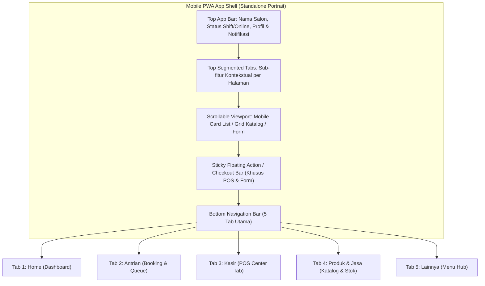
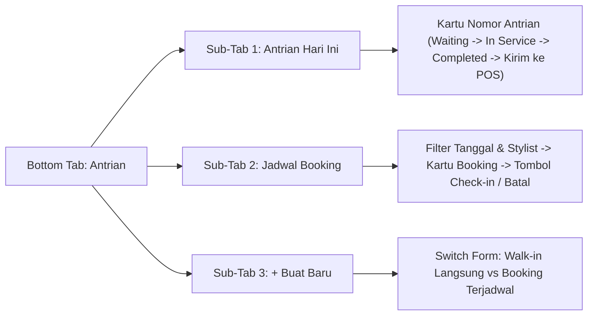
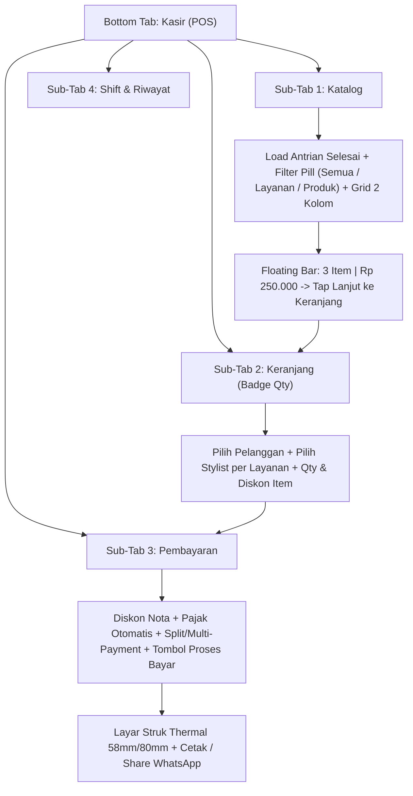
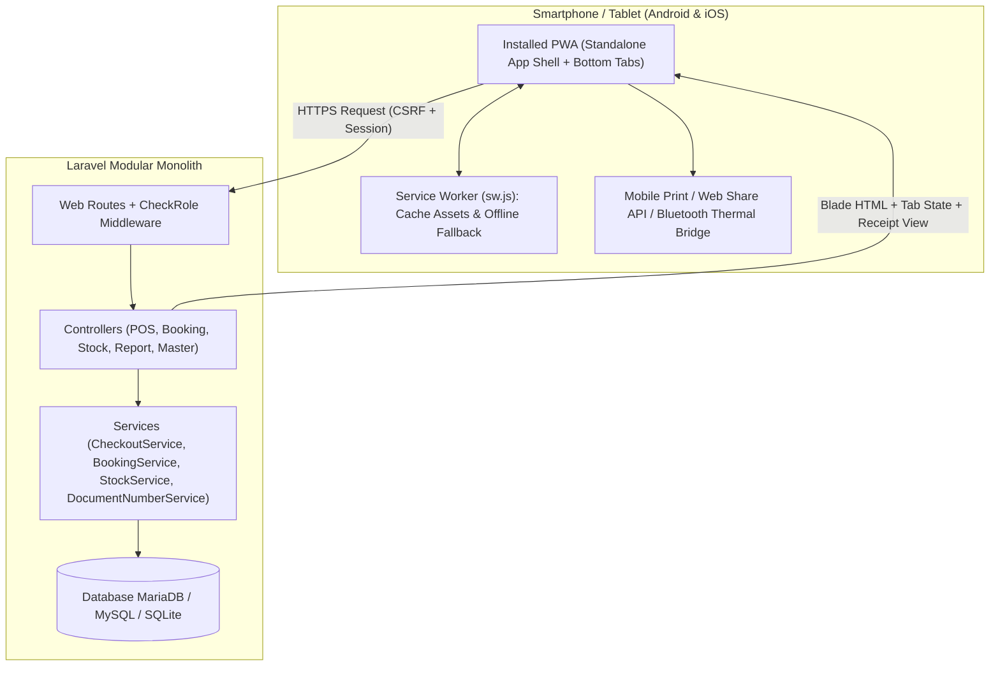

# DESAIN --- Salon Management System & POS (Mobile-First PWA & Tab UI)

**Versi:** 2.0 (Mobile Apps PWA Edition)\
**Tanggal:** 14 November 2026\
**Acuan:** `prd.md`

---

## 1. Prinsip Desain (Mobile-First PWA)

1. **Satu Cabang, Satu Aplikasi Laravel Berwajah Native Mobile App:** Aplikasi dibangun menggunakan Laravel + Blade yang dioptimalkan penuh sebagai **Progressive Web App (PWA)** dengan mode `standalone` (tanpa *address bar* browser) dan orientasi utama `portrait`.
2. **Navigasi Berbasis Tab (2-Tier Tab Architecture):**
   - **Bottom Navigation Bar (5 Tab Utama):** Menempel di bagian bawah layar (*thumb zone*) layaknya aplikasi mobile native (Gojek/Fresha/Moka POS Mobile) untuk berpindah antar modul utama.
   - **Top Segmented Tabs (Sub-Tab Kontekstual):** Berada di bawah *Top App Bar* pada setiap halaman untuk berpindah antar sub-fitur atau tahapan alur kerja tanpa berpindah halaman penuh.
3. **Ergonomi Sentuh (*Touch-First Ergonomics*):**
   - Seluruh tombol, tab, dan kartu item memiliki area sentuh minimal `44x44 px` hingga `48x48 px`.
   - Mengganti tabel lebar (*wide data tables*) menjadi **Mobile Card List** yang ringkas dengan *badge* status dan tombol aksi cepat.
   - Mengganti modal tengah konvensional dengan **Slide-Up Bottom Sheet** agar mudah dijangkau satu tangan (ibu jari).
4. **Operasi Kasir Mobile Ringkas (3-Tab POS Flow + Floating Bar):** Panel Katalog, Keranjang, dan Pembayaran diorganisasikan menjadi 3 *Segmented Tabs* dengan **Sticky Floating Checkout Bar** di atas Bottom Navigation.
5. **Backend sebagai Sumber Kebenaran Tunggal:** Harga, stok, diskon, pajak, pembayaran, dan komisi dihitung serta divalidasi di server dalam transaksi database.
6. **PWA Online-First dengan Proteksi Koneksi:** PWA menyediakan instalasi ke *Home Screen*, *splash screen*, caching aset statis (*app shell*), dan deteksi koneksi *real-time*. Checkout dan mutasi stok tetap mewajibkan koneksi aktif pada MVP untuk mencegah konflik stok/jadwal.

---

## 2. Arsitektur Navigasi Mobile (Tab Navigation)

Pada tampilan mobile apps, sidebar bertingkat digantikan oleh kombinasi **Bottom Navigation Bar** dan **Top Segmented Tabs** yang dirender sesuai hak akses role (`role_menu`).

### 2.1 Struktur 5 Tab Utama (Bottom Navigation Bar)

| Urutan | Nama Tab | Ikon | Route Utama | Isi & Kegunaan Utama |
| :---: | :--- | :--- | :--- | :--- |
| **1** | **Home** | `fa-home` | `/dashboard` | Ringkasan KPI harian, pintasan cepat (+Booking, +Walk-in, Buka Shift), antrian aktif, top stylist. |
| **2** | **Antrian** | `fa-calendar-check` | `/bookings` | Mengelola antrian layanan hari ini (`ServiceOrder`), jadwal booking, dan tambah Walk-in/Booking. |
| **3** | **Kasir (POS)** | `fa-cash-register` | `/pos` | *(Center Highlighted Tab)* Transaksi kasir, keranjang belanja, multi-payment, shift kasir, dan riwayat/refund. |
| **4** | **Katalog** | `fa-boxes` | `/products` & `/stocks` | Katalog layanan & harga, daftar produk retail, serta mutasi & kartu stok. |
| **5** | **Lainnya** | `fa-th-large` | Menu Drawer / Hub | Akses ke Pelanggan, Stylish & Jadwal/Cuti, Laporan & Export CSV, Manajemen User, serta Pengaturan Salon & Printer. |

### 2.2 Pemetaan Submenu ke Top Segmented Tabs

Setiap menu utama menggunakan **Top Segmented Tabs (Pill/Underline Tabs)** di bagian atas halaman agar pengguna tidak perlu membuka sidebar:

| Menu Utama (Bottom Tab) | Top Segmented Tabs (Sub-Tab di Dalam Halaman) |
| :--- | :--- |
| **1. Home (`Dashboard`)** | `[Ringkasan Hari Ini]` \| `[Antrian Berjalan]` \| `[Performa Stylist]` |
| **2. Antrian (`Booking & Antrian`)** | `[Antrian Hari Ini]` \| `[Jadwal Booking]` \| `[+ Walk-in / Booking]` \| `[Riwayat]` |
| **3. Kasir (`POS`)** | `[1. Katalog]` \| `[2. Keranjang (Badge)]` \| `[3. Bayar]` \| `[Shift Kasir]` \| `[Riwayat & Refund]` |
| **4. Katalog (`Layanan & Stok`)** | `[Layanan & Harga]` \| `[Daftar Produk]` \| `[Mutasi & Kartu Stok]` \| `[Master Kategori/Supplier]` |
| **5a. Pelanggan (via Lainnya)** | `[Daftar Pelanggan]` \| `[+ Tambah Pelanggan]` |
| **5b. Stylish (via Lainnya)** | `[Daftar Stylist]` \| `[Jadwal Mingguan]` \| `[Cuti & Izin]` |
| **5c. Laporan (via Lainnya)** | `[Penjualan]` \| `[Komisi Stylist]` \| `[Item Terlaris]` \| `[Pergerakan Stok]` |
| **5d. Manajemen User (via Lainnya)** | `[Users]` \| `[Role & Akses]` \| `[Menu]` \| `[Audit Log]` \| `[Ganti Password]` |
| **5e. Pengaturan (via Lainnya)** | `[Profil & Jam]` \| `[Pajak & Prefix]` \| `[Printer & Struk]` \| `[Metode Bayar]` |

---

## 3. Design System Mobile PWA

### 3.1 Gaya Visual & Dimensi Mobile
- **Tema Warna:** Latar belakang bersih (`#F8F7FA`), permukaan kartu putih (`#FFFFFF`), aksen utama *Salon Rose* (`#E11D48` / `#BE185D`) dan *Soft Violet* (`#7C3AED`).
- **Viewport & Safe Area:**
  - Menggunakan `viewport-fit=cover` agar tampilan penuh di layar ponsel modern.
  - Padding atas mengikuti `env(safe-area-inset-top)` dan padding bawah mengikuti `calc(64px + env(safe-area-inset-bottom))` agar konten tidak tertutup Bottom Navigation Bar.
- **Kontrol Gestur & Scroll:**
  - `overscroll-behavior-y: contain` untuk mencegah *pull-to-refresh* tidak sengaja saat kasir sedang menggeser keranjang belanja.
  - `-webkit-tap-highlight-color: transparent` dan `user-select: none` pada elemen navigasi serta tombol kasir agar terasa seperti aplikasi native.

### 3.2 Komponen UI Khas Mobile App
1. **Top App Bar (Sticky, Tinggi `56px`):** Menampilkan judul halaman/nama salon, indikator status shift (`Shift Open` / `Closed`), indikator jaringan (`Online` / `Offline`), dan tombol aksi kanan.
2. **Segmented Control / Pill Tabs (Sticky di bawah Top Bar, Tinggi `44px`):** Mendukung *horizontal scroll* lembut (`overflow-x: auto; scrollbar-width: none`) jika jumlah tab lebih dari 3.
3. **Mobile Card List (Pengganti Tabel Desktop):** Setiap baris data ditampilkan sebagai kartu vertikal berisi judul tebal, sub-informasi (waktu/telepon/kategori), *status pill badge* di kanan atas, dan deretan tombol aksi di bagian bawah kartu.
4. **Slide-Up Bottom Sheet:** Digunakan untuk memilih stylist per item layanan, menginput diskon, mengisi form mutasi stok, atau mengonfirmasi refund/void.
5. **Floating Checkout Bar (Khusus POS):** Bar melayang tepat di atas Bottom Navigation yang menampilkan jumlah item, total tagihan (`Rp ...`), dan tombol utama `Bayar Sekarang`.

### 3.3 Status Visual (Badge Warna + Teks)

| Status | Warna Badge | Makna Operasional |
| :--- | :--- | :--- |
| `Booked` / `Confirmed` | Biru (`bg-info`) | Booking terjadwal & terkonfirmasi |
| `Waiting` / `Called` | Kuning/Oranye (`bg-warning`) | Pelanggan sudah check-in, menunggu giliran |
| `In Service` | Ungu/Primer (`bg-primary`) | Sedang dilayani oleh stylist |
| `Completed` | Hijau (`bg-success`) | Layanan selesai, siap dibayar di kasir |
| `Paid` | Hijau Tua (`bg-success`) | Transaksi POS lunas |
| `Refunded` / `Cancelled` | Merah (`bg-danger`) | Transaksi di-refund / booking dibatalkan |

---

## 4. Rancangan Layar Mobile per Modul (Wireframe & Alur Tab)

### 4.1 Tab 1: Home (`Dashboard` — `/dashboard`)

- **Top Segmented Tabs:**
  - **Tab `[Ringkasan Hari Ini]`:**
    - **Grid KPI 2x3:** Booking Hari Ini, Antrian Aktif, Transaksi Lunas, Omzet Bersih Hari Ini, Stok Menipis, Total Pelanggan.
    - **Quick Action Pills:** Tombol cepat `+ Walk-in`, `+ Booking`, `Buka POS`, `Stok Masuk`.
  - **Tab `[Antrian Berjalan]`:** Daftar kartu antrian aktif hari ini beserta tombol pintas `Ke POS`.
  - **Tab `[Performa Stylist]`:** Kartu peringkat stylist bulan ini (jumlah layanan & total komisi) serta daftar 6 transaksi terakhir.

### 4.2 Tab 2: Antrian (`Booking dan Antrian` — `/bookings`)

- **Sub-Tab `[Antrian Hari Ini]`:**
  - Menampilkan kartu antrian berurutan berdasarkan `queue_number` (`A001`, `A002`, dst.).
  - Setiap kartu memiliki tombol *1-tap status progression*: `Panggil` -> `Mulai Layanan` -> `Selesai` -> `Kirim ke Kasir POS`.
- **Sub-Tab `[Jadwal Booking]`:**
  - *Horizontal Date Picker* / filter tanggal di bagian atas.
  - Daftar kartu reservasi dengan jam mulai–selesai, daftar layanan, nama stylist, dan tombol `Check-in` (langsung memindahkan ke tab `Antrian Hari Ini`).
- **Sub-Tab `[+ Buat Baru]`:**
  - Pilihan mode di bagian atas form: **`[Walk-in Langsung]`** atau **`[Reservasi Terjadwal]`**.
  - Pilihan layanan menggunakan *chip/card selector* yang ramah sentuhan.

### 4.3 Tab 3: Kasir (`POS Mobile` — `/pos`, `/cash-shifts`, `/transactions`)

Pada layar mobile, 3-panel desktop ditransformasikan menjadi **Segmented Workflow Tabs** dengan **Sticky Floating Checkout Bar**:

1. **Sub-Tab `[1. Katalog]`:**
   - Baris atas: *Horizontal chip* **Antrian Siap Bayar** (1-tap untuk memuat seluruh layanan pelanggan dari antrian ke keranjang).
   - *Sticky Search Bar* + *Filter Pill* (`Semua`, `Layanan`, `Produk`, beserta kategori).
   - **Grid Katalog 2 Kolom:** Kartu kompak menampilkan nama item, durasi/sisa stok, harga, dan indikator jumlah yang sudah masuk keranjang.
   - **Sticky Floating Bar di Bawah:** Menampilkan total sementara dan tombol `Lihat Keranjang (N)`.
2. **Sub-Tab `[2. Keranjang]`:**
   - Pemilih Pelanggan (*searchable select* / pelanggan umum).
   - Kartu per baris item: tombol `[-] [Qty] [+]`, dropdown **Pilih Stylist** (wajib/opsional untuk layanan), dan input diskon item.
   - Ringkasan Subtotal, Diskon Faktur, PPN Otomatis, dan **Grand Total**.
3. **Sub-Tab `[3. Bayar]`:**
   - Tombol nominal cepat (*Quick Cash Chips*: `Uang Pas`, `Rp 50.000`, `Rp 100.000`, `Rp 200.000`).
   - Dukungan **Multi-Payment / Split Payment** (tambah baris pembayaran: Tunai, QRIS, Transfer, EDC) beserta input nomor referensi.
   - Kalkulasi **Total Dibayar** dan **Kembalian** secara *real-time*.
   - Tombol penuh `Selesaikan & Cetak Struk` dengan proteksi *idempotency* dan indikator loading.
4. **Sub-Tab `[Shift]` & `[Riwayat]`:**
   - Membuka halaman Shift Kasir (`/cash-shifts` dengan tab `[Shift Aktif]` dan `[Riwayat Shift]`) serta Riwayat Transaksi & Refund (`/transactions` dengan *Bottom Sheet* form Refund/Void).

### 4.4 Tab 4: Katalog & Stok (`/products`, `/stocks`, `/services`)

- **Top Segmented Tabs:**
  - **Sub-Tab `[Produk]`:** Pencarian SKU/nama, filter stok menipis (*Low Stock Badge*), kartu produk dengan informasi harga beli, harga jual, dan saldo stok saat ini.
  - **Sub-Tab `[Mutasi & Kartu Stok]`:**
    - Sub-switch di dalam tab: **`[Catat Mutasi Baru]`** (Stok Masuk `in`, Pemakaian Internal `usage`, Opname `adjustment`) dan **`[Riwayat Kartu Stok]`** (daftar kartu mutasi masuk/keluar beserta saldo akhir).
  - **Sub-Tab `[Layanan & Harga]`:** Daftar kartu layanan salon beserta durasi menit, harga jual, dan skema komisi stylist (`%` atau `Rp`).
  - **Sub-Tab `[Master Pendukung]`:** Pintasan tab ke Kategori Layanan, Kategori Produk, Satuan Produk, dan Supplier.

### 4.5 Tab 5: Lainnya (`Menu Hub`)

Ketika pengguna menekan tab **Lainnya** di Bottom Navigation Bar, muncul **Bottom Sheet Menu Hub** (atau halaman grid ikon mobile) yang mengelompokkan modul pendukung berdasarkan hak akses:

1. **Pelanggan (`/customers`):**
   - Sub-Tab `[Daftar Pelanggan]` (kartu pelanggan dengan tombol telepon/WA cepat & catatan alergi) dan `[+ Tambah Baru]`.
2. **Stylish (`/stylists` & `/stylist-schedules`):**
   - Sub-Tab `[Daftar Stylist]`, `[Jadwal Kerja 7 Hari]` (toggle jam kerja/libur per hari dengan *mobile switch*), dan `[Cuti & Izin]`.
3. **Laporan (`/reports`):**
   - Filter periode tanggal ringkas di atas, diikuti 4 *Segmented Tabs*: `[Penjualan]`, `[Komisi Stylist]`, `[Item Terlaris]`, dan `[Pergerakan Stok]`, lengkap dengan tombol **Unduh CSV** di setiap tab.
4. **Manajemen User (`/users`, `/roles`, `/menus`, `/audit-logs`, `/ganti-password`):**
   - Dikelompokkan dengan *Top Segmented Tabs* untuk memudahkan Owner/Admin mengelola akun, matriks akses menu (`role_menu`), dan memantau *Audit Log* dari ponsel.
5. **Pengaturan (`/salon-settings`, `/payment-methods`):**
   - Sub-Tab `[Profil & Jam Buka]`, `[Pajak & Nomor Dokumen]`, `[Printer Thermal 58mm/80mm]`, dan `[Metode Pembayaran]`.

---

## 5. Arsitektur Aplikasi Mobile PWA

---

## 6. Rancangan Data

Skema database tetap mempertahankan 26 tabel transaksional yang utuh dan konsisten antara versi desktop maupun mobile PWA:
- **Identity & Audit:** `users`, `role`, `menu`, `role_menu`, `audit_logs`
- **Master Data:** `customers`, `employees`, `employee_schedules`, `employee_leaves`, `service_categories`, `services`, `product_categories`, `units`, `suppliers`, `products`, `payment_methods`
- **Booking & Antrian:** `appointments`, `appointment_details`, `service_orders`, `service_order_details`
- **POS & Shift:** `cash_shifts`, `transactions`, `transaction_details`, `payments`, `transaction_refunds`
- **Inventori & Komisi:** `stock_headers`, `stock_details`, `employee_commissions`
- **Pengaturan & Penomoran:** `salon_settings`, `document_sequences`

---

## 7. Desain Cetak Struk Thermal di Mobile PWA

Pada perangkat mobile (Android/iOS), pencetakan struk `/pos/transactions/{transaction}/receipt` dirancang mendukung 3 metode:

1. **Metode 1 — Browser Print / Sistem Cetak OS (`window.print()`):**
   - Mendukung printer thermal Wi-Fi/LAN atau printer yang terhubung melalui *Android Print Service* / *Apple AirPrint* dengan ukuran kertas `58mm` (area cetak `48mm`) dan `80mm` (area cetak `72mm`).
2. **Metode 2 — Kirim Struk Digital via Web Share API (`navigator.share`):**
   - Tombol **Bagikan Struk** di layar receipt mobile memungkinkan kasir mengirimkan ringkasan/tautan struk langsung ke WhatsApp pelanggan.
3. **Metode 3 — Printer Thermal Bluetooth (RawBT / Print Bridge Intent):**
   - Menyediakan opsi tombol cetak cepat ke aplikasi print bridge Android (seperti *RawBT* atau *ESC/POS Bluetooth Print Service*) untuk printer thermal Bluetooth portabel 58mm/80mm tanpa perlu komputer kasir.

---

## 8. Spesifikasi PWA (Progressive Web App)

1. **Web App Manifest (`public/manifest.webmanifest`):**
   - `display: "standalone"` dan `orientation: "portrait"`.
   - `theme_color: "#e11d48"` dan `background_color: "#f8f7fa"`.
   - Menyertakan `shortcuts` aplikasi (tekan lama ikon aplikasi di Home Screen untuk langsung membuka **Kasir POS**, **Booking & Antrian**, atau **Mutasi Stok**).
2. **Service Worker (`public/sw.js`):**
   - **Cache-First** untuk aset statis (CSS, JS, FontAwesome, Fonts, Ikon).
   - **Network-First** untuk navigasi halaman GET dengan fallback ke halaman offline informatif jika jaringan terputus.
   - **Network-Only** untuk seluruh endpoint transaksi (`POST /pos/checkout`, refund, stok, login/logout) demi menjaga integritas data.
3. **Install Banner & Offline Banner:**
   - Menampilkan tombol **Install Aplikasi** di Top Bar / Menu Lainnya saat browser mendukung `beforeinstallprompt`.
   - Menampilkan *toast/banner* peringatan otomatis di bagian atas layar ketika ponsel kehilangan koneksi internet (`offline`), sekaligus mengunci tombol submit transaksi hingga koneksi kembali (`online`).
