# Dokumentasi Alur Penggunaan, Flowchart, dan Penjelasan Menu — GlowSalon POS

Dokumen ini menjelaskan alur penggunaan aplikasi **GlowSalon POS** secara menyeluruh dalam bentuk **flowchart per menu**, lengkap dengan **kegunaan**, **daftar fitur**, dan **hak akses role** berdasarkan implementasi sistem pada kode aplikasi.

---

## Ringkasan Hak Akses Role

| Role | Akses Menu Utama |
| :--- | :--- |
| **Owner / Admin** (`admin@cms.test`) | Seluruh 29 menu (Dashboard, Booking, Kasir, Pelanggan, Layanan, Stylish, Stok Produk, Laporan, Manajemen User, Pengaturan) |
| **Admin / Resepsionis** (`resepsionis@salon.test`) | Dashboard, Booking & Antrian, Pelanggan, Layanan & Harga, Stylish, Laporan, Ganti Password |
| **Kasir** (`kasir@salon.test`) | Dashboard, Booking & Antrian, Kasir (POS, Riwayat & Refund, Shift), Pelanggan, Daftar Layanan, Daftar Produk, Ganti Password |
| **Stylist** (`stylist@salon.test`) | Dashboard, Booking & Antrian, Stylish (Daftar & Jadwal/Cuti), Ganti Password |
| **Petugas Stok** (`stok@salon.test`) | Dashboard, Stok Produk (Daftar, Mutasi/Kartu Stok, Kategori, Satuan, Supplier), Laporan, Ganti Password |

> **Password default seluruh akun seeder:** `1234`

---

## 0. Flowchart Alur Utama Sistem (End-to-End)

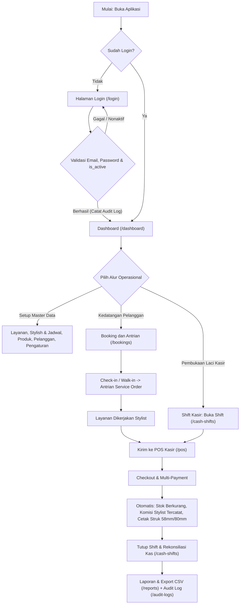

---

## 1. Menu: Dashboard (`/dashboard`)

- **Kegunaan:** Pusat pemantauan operasional harian salon secara *real-time* segera setelah pengguna login.
- **Fitur Utama:**
  - **Ringkasan KPI Harian:** Jumlah booking hari ini, antrian aktif (`waiting`, `called`, `in_service`), jumlah transaksi lunas hari ini, total penjualan bersih (*net sales*) hari ini, jumlah produk dengan stok menipis (`current_stock <= min_stock`), dan total pelanggan aktif.
  - **Tabel Antrian Aktif Hari Ini:** Menampilkan nomor antrian, nama pelanggan, stylist yang menangani, dan status layanan terkini.
  - **Transaksi Terbaru:** Daftar 6 transaksi terakhir beserta metode pembayarannya.
  - **Top Stylist Bulan Ini:** Peringkat stylist berdasarkan jumlah layanan dan akumulasi komisi berstatus `earned` pada bulan berjalan.

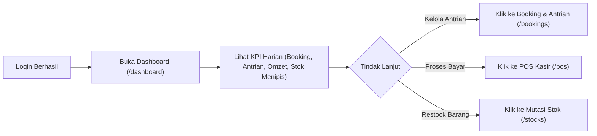

---

## 2. Menu: Booking dan Antrian (`/bookings`)

- **Kegunaan:** Mengelola reservasi jadwal pelanggan (*appointment*) sekaligus antrian layanan langsung di tempat (*walk-in queue*) sebelum masuk ke kasir.
- **Fitur Utama:**
  - **Buat Booking Terjadwal:** Memilih pelanggan, tanggal, jam mulai, layanan (bisa lebih dari satu), dan stylist. Sistem otomatis memvalidasi jam buka/tutup salon, jadwal kerja & cuti stylist, serta mencegah bentrok slot waktu (*overlapping appointment*).
  - **Tambah Antrian Walk-in:** Pelanggan datang langsung tanpa reservasi dapat langsung dimasukkan ke antrian hari ini (`ServiceOrder`) dengan nomor antrian otomatis.
  - **Check-in Booking:** Mengubah booking berstatus `confirmed`/`booked` menjadi antrian aktif (`ServiceOrder`).
  - **Update Status Booking & Antrian:** Mengubah status booking (`booked`, `confirmed`, `cancelled`, `no_show`) dan progres antrian (`waiting` -> `called` -> `in_service` -> `completed`).
  - **Kirim ke Kasir POS:** Tombol pintasan pada antrian untuk langsung memuat data pelanggan, layanan, dan stylist ke halaman `/pos`.

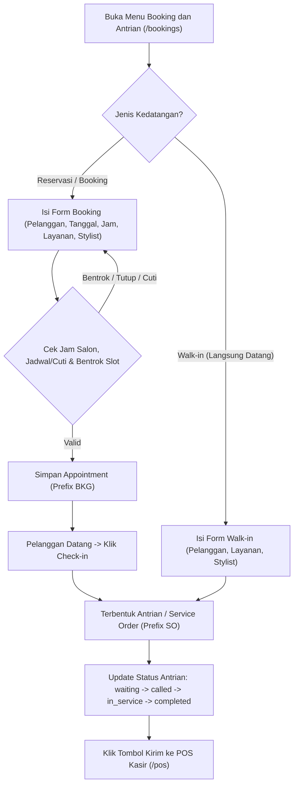

---

## 3. Menu: Kasir

Menu **Kasir** memiliki 3 submenu utama: **Shift Kasir**, **POS Kasir**, dan **Riwayat & Refund**.

### 3a. Submenu: Shift Kasir (`/cash-shifts`)
- **Kegunaan:** Mengelola pembukaan dan penutupan laci kasir (*cash drawer*) per shift serta melakukan rekonsiliasi uang tunai fisik terhadap uang tunai sistem.
- **Fitur Utama:**
  - **Buka Shift:** Menginput modal awal kas (*opening cash*) dan catatan shift untuk mendapatkan nomor shift otomatis (`SHF-YYYYMMDD-XXXXXX`). Kasir wajib memiliki shift berstatus `open` sebelum dapat melakukan checkout di POS.
  - **Tutup Shift & Rekonsiliasi:** Menginput jumlah uang tunai fisik (*actual cash*) saat pergantian/akhir hari. Sistem otomatis menghitung `expected_cash` (modal awal + pembayaran tunai - refund tunai) dan menampilkan selisih kas (*variance*).

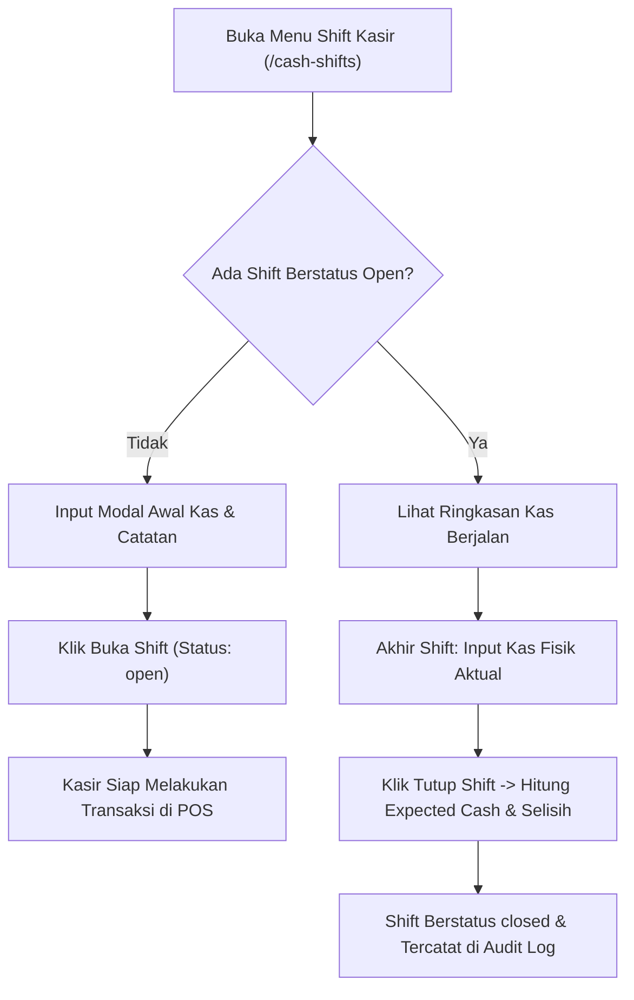

### 3b. Submenu: POS Kasir (`/pos`)
- **Kegunaan:** Halaman transaksi utama kasir dengan tata letak 3-panel untuk memproses pembayaran layanan salon dan produk retail secara cepat.
- **Fitur Utama:**
  - **Panel 1 (Antrian & Filter):** *Quick load* antrian layanan aktif/selesai (`ServiceOrder`) agar item otomatis masuk ke keranjang, serta filter kategori layanan & produk.
  - **Panel 2 (Katalog Item):** Menampilkan daftar layanan dan produk retail lengkap dengan harga dan sisa stok *real-time*.
  - **Panel 3 (Keranjang & Pembayaran):**
    - Pilih atau ubah **Stylist** per item layanan (menentukan penerima komisi).
    - Atur kuantitas, diskon per item, serta diskon global faktur (*invoice*).
    - Perhitungan **PPN/Pajak** otomatis sesuai persentase di Pengaturan Salon.
    - **Multi-Payment / Split Payment:** Pelanggan dapat membayar menggunakan kombinasi beberapa metode pembayaran (misalnya sebagian Tunai dan sebagian QRIS/Transfer/Debit) beserta kalkulasi kembalian otomatis.
  - **Efek Otomatis saat Checkout:** Membuat nomor invoice (`TRX`), mengurangi stok produk di kartu stok (`out`), mencatat komisi stylist (`earned`), menandai antrian menjadi `completed`, dan mengarahkan ke halaman **Struk Thermal (58mm / 80mm)**.

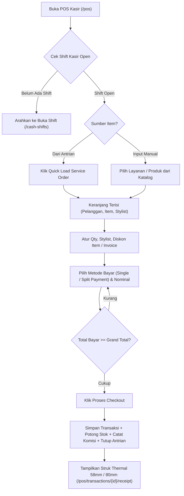

### 3c. Submenu: Riwayat & Refund (`/transactions`)
- **Kegunaan:** Memantau seluruh riwayat transaksi POS, mencetak ulang struk, dan memproses pembatalan (*void*) atau pengembalian dana (*refund*) secara terkontrol.
- **Fitur Utama:**
  - **Filter Riwayat:** Cari berdasarkan tanggal atau nomor transaksi.
  - **Cetak Ulang Struk:** Membuka kembali halaman struk thermal 58mm/80mm untuk transaksi mana pun.
  - **Proses Refund / Void:** Membutuhkan alasan refund wajib. Saat diproses, status transaksi berubah menjadi `refunded`/`void`, komisi stylist pada transaksi tersebut otomatis dibatalkan (`voided`), kas shift disesuaikan jika pembayaran tunai, dan tersedia opsi **Kembalikan Stok Produk (*Restock*)** yang mencatat mutasi masuk di kartu stok serta jejak di `audit_logs`.

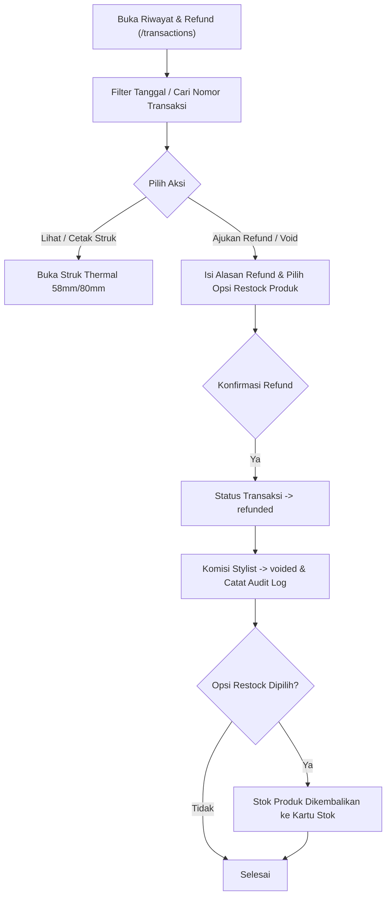

---

## 4. Menu: Pelanggan (`/customers`)

- **Kegunaan:** Mengelola database pelanggan (*CRM sederhana*) untuk memudahkan pencatatan riwayat kunjungan dan identifikasi pelanggan saat booking maupun di kasir.
- **Fitur Utama:**
  - Tambah, ubah, cari, dan hapus/nonaktifkan data pelanggan (kode pelanggan, nama, no. HP, email, jenis kelamin, tanggal lahir, catatan khusus/alergi, status aktif).

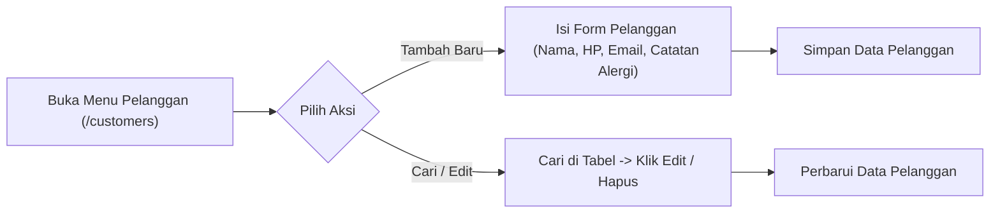

---

## 5. Menu: Layanan dan Harga

Menu ini terdiri dari 2 submenu untuk mengatur katalog jasa salon:
1. **Kategori Layanan (`/service-categories`):** Mengelompokkan jenis perawatan (misal: *Hair Cut & Styling*, *Hair Treatment & Spa*, *Hair Coloring & Perm*, *Nail Care & Art*).
2. **Daftar Layanan (`/services`):** Mengelola detail tiap layanan, meliputi kode layanan, kategori, nama layanan, **durasi pengerjaan (menit)** (dipakai untuk kalkulasi slot waktu booking), **harga jual**, **tipe komisi stylist** (`percentage` % atau `fixed` nominal Rp), **nilai komisi**, dan status aktif.

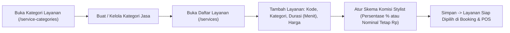

---

## 6. Menu: Stylish

Menu ini terdiri dari 2 submenu untuk manajemen SDM terapis/stylist:
1. **Daftar Stylist (`/stylists`):** Mengelola profil karyawan/stylist (kode karyawan, nama, spesialisasi, no. HP, status aktif, dan penautan ke akun user jika ada).
2. **Jadwal & Cuti (`/stylist-schedules`):**
   - **Jadwal Kerja Mingguan:** Mengatur hari kerja (`Senin`–`Minggu`), jam mulai, jam selesai, dan status libur mingguan per stylist.
   - **Pengajuan & Manajemen Cuti:** Menambahkan atau menghapus tanggal cuti/izin stylist beserta alasannya. Data ini dibaca langsung oleh modul **Booking** untuk menolak reservasi saat stylist libur atau cuti.

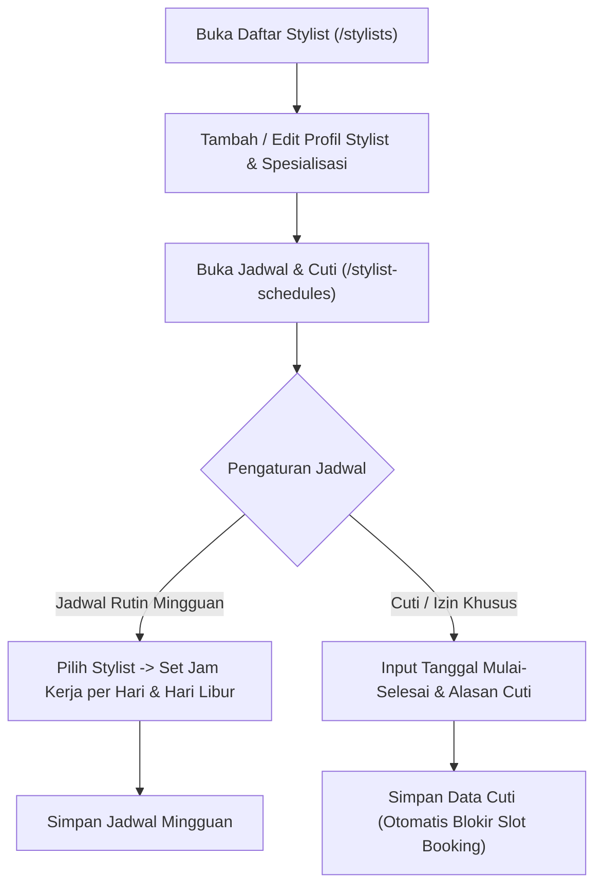

---

## 7. Menu: Stok Produk

Menu ini terdiri dari 5 submenu untuk pengelolaan inventori barang retail maupun bahan pemakaian internal salon:
1. **Kategori Produk (`/product-categories`):** Pengelompokan produk (misal: *Hair Care*, *Styling*, *Coloring*).
2. **Satuan Produk (`/units`):** Master satuan barang (misal: *Botol*, *Pcs*, *Tube*, *Box*).
3. **Supplier (`/suppliers`):** Master data pemasok barang (nama, kontak, alamat).
4. **Daftar Produk (`/products`):** Master SKU produk beserta kategori, satuan, harga beli (*cost*), harga jual (*retail price*), stok saat ini, dan **batas stok minimum (`min_stock`)** untuk peringatan di Dashboard.
5. **Mutasi & Kartu Stok (`/stocks`):**
   - **Catat Mutasi Manual:** Mendukung **Stok Masuk (`in`)** dari supplier, **Pemakaian Internal (`usage`)** untuk operasional salon, dan **Penyesuaian / Opname (`adjustment`)**.
   - **Kartu Stok (*Stock Ledger*):** Menampilkan riwayat keluar-masuk setiap produk secara kronologis beserta saldo akhir, termasuk pemotongan otomatis (`out`) dari penjualan POS dan pengembalian (`in`) dari refund.

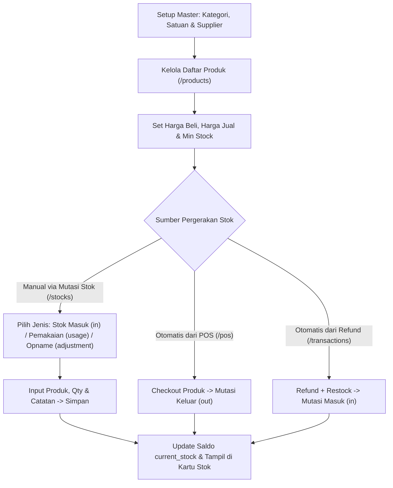

---

## 8. Menu: Laporan (`/reports`)

- **Kegunaan:** Menyediakan analisis performa bisnis salon berdasarkan rentang tanggal tertentu dan mengekspornya ke format spreadsheet.
- **Fitur Utama:**
  - **Filter Periode:** Memilih tanggal mulai dan tanggal akhir laporan.
  - **4 Tab Laporan Terpadu:**
    1. **Laporan Penjualan:** Ringkasan total transaksi, subtotal, diskon, pajak, dan grand total per transaksi.
    2. **Komisi Stylist:** Rekapitulasi jumlah layanan dan total komisi yang diperoleh (`earned`) oleh masing-masing stylist.
    3. **Item Terlaris:** Peringkat layanan dan produk dengan volume penjualan serta omzet tertinggi.
    4. **Pergerakan Stok:** Rekap mutasi stok masuk, keluar, pemakaian internal, dan penyesuaian.
  - **Export CSV:** Setiap tab memiliki tombol **Export CSV** untuk mengunduh data laporan sesuai filter tanggal yang sedang aktif.

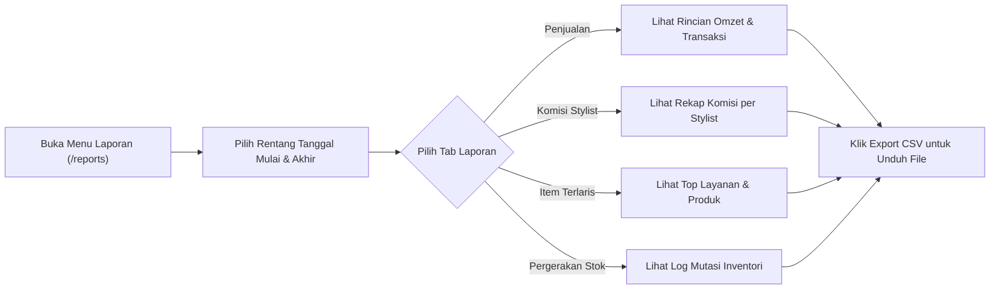

---

## 9. Menu: Manajemen User

Menu ini terdiri dari 5 submenu untuk kontrol akses, keamanan, dan pelacakan aktivitas:
1. **Users (`/users`):** Tambah, edit, dan nonaktifkan akun pengguna (`is_active`), serta menentukan role masing-masing pengguna.
2. **Role (`/roles`):** Mengelola daftar peran pengguna dan mengatur **Matriks Hak Akses Menu (`role_menu`)** melalui halaman kelola menu per role.
3. **Menu (`/menus`):** Mengelola struktur menu sidebar (nama, route, parent menu, ikon, urutan, status aktif).
4. **Audit Log (`/audit-logs`):** Melihat catatan jejak aktivitas penting sistem (login, perubahan pengaturan, refund/void transaksi, pembukaan/penutupan shift) beserta waktu, pelaku, dan deskripsi aksi.
5. **Ganti Password (`/ganti-password`):** Memungkinkan pengguna yang sedang login untuk memperbarui kata sandinya sendiri dengan validasi password lama.

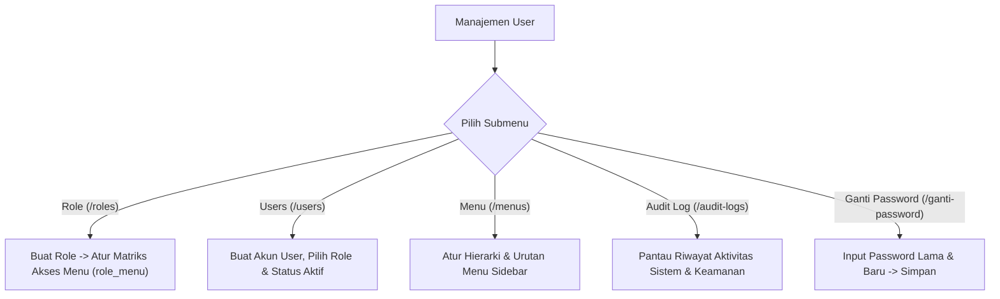

---

## 10. Menu: Pengaturan

Menu ini terdiri dari 2 submenu untuk konfigurasi identitas salon dan kanal pembayaran:
1. **Profil & Printer (`/salon-settings`):**
   - Identitas salon (nama salon, tagline, alamat, telepon, email) yang tampil pada header aplikasi dan struk.
   - Jam operasional (`open_time` & `close_time`) sebagai batas validasi booking.
   - Pengaturan pajak (PPN %), diskon default, serta prefix penomoran otomatis (`BKG`, `SO`, `TRX`).
   - Pengaturan printer struk thermal: pilihan lebar kertas **`58mm` atau `80mm`**, teks *footer* struk, dan batas default peringatan stok menipis.
2. **Metode Pembayaran (`/payment-methods`):**
   - Mengelola daftar metode pembayaran yang muncul di kasir POS (misal: *Tunai*, *QRIS*, *Transfer Bank*, *Kartu Debit/Kredit*), lengkap dengan tipe (`cash`, `qris`, `transfer`, `card`), nomor rekening/merchant, dan status aktif.

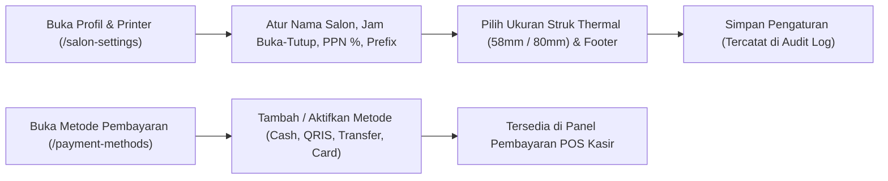
